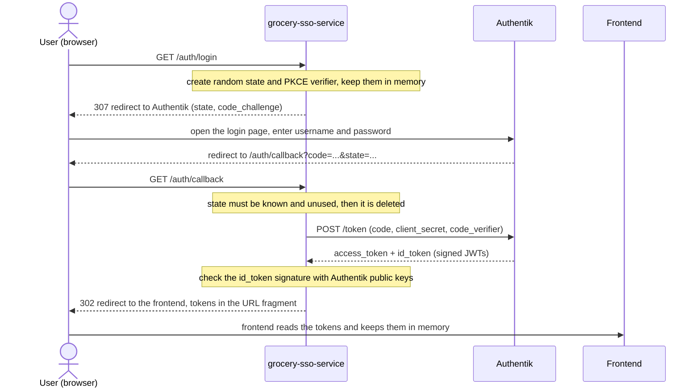
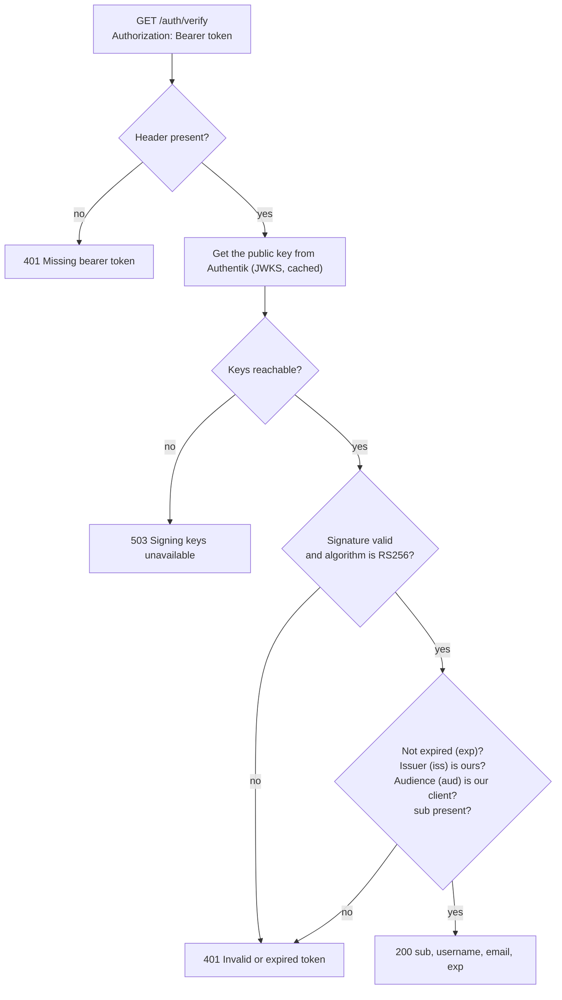

# grocery-sso-service

Process-centric service for the Grocery List Manager. It runs the OAuth 2.0 / OIDC
login flow against Authentik and validates the JWTs used by the other services.

## Endpoints

| Method | Path | Purpose |
|---|---|---|
| GET | `/auth/login` | Redirects the browser to Authentik (state + PKCE) |
| GET | `/auth/callback` | Receives the code, exchanges it for tokens, checks the `id_token` |
| GET | `/auth/verify` | Validates `Authorization: Bearer <JWT>`, returns `sub`, username, email, `exp` |
| GET | `/health` | Liveness probe |

The full API is in [openapi.yaml](openapi.yaml) (regenerate it with
`python scripts/export_openapi.py`; a test fails if it is out of date).

## How it works

The service never sees a password: users type their credentials only on Authentik.
It uses the **Authorization Code flow with PKCE**.

### Login flow



Why each piece is there:

- **state**: a random value tied to one login attempt. A callback with an unknown or
  already used state is rejected (protects against CSRF).
- **PKCE** (`code_challenge` / `code_verifier`): binds the authorization code to the
  service that started the login, so a stolen code is useless.
- **client_secret**: sent only in the server-to-server token request, never to the browser.
- **URL fragment**: the part after `#` is not sent to servers and does not end up in logs.
  If `FRONTEND_URL` is not set, the callback returns the tokens as JSON instead.

### Token validation flow

Other services (for example the orchestrator) call `GET /auth/verify` with the user's
token. Every check must pass, otherwise the answer is `401`.



The `sub` returned here is the user id that the backend uses as the owner of grocery lists.

### Code map

| File | Role |
|---|---|
| `app/main.py` | The endpoints and how everything is wired together |
| `app/token_validator.py` | JWT checks (signature, `exp`, `iss`, `aud`, `sub`) |
| `app/state_store.py` | In-memory, single-use storage for `state` and the PKCE verifier |
| `app/config.py` | Settings read from environment variables |
| `app/schemas.py` | JSON response models used in the OpenAPI file |

## Configuration (environment variables)

| Variable | Default | Notes |
|---|---|---|
| `OIDC_CLIENT_SECRET` | – (required) | Secret of the Authentik provider |
| `OIDC_CLIENT_ID` | `grocery-sso` | |
| `OIDC_BASE_URL` | `http://localhost:9000` | Base for the three URLs below |
| `OIDC_ISSUER` | `<base>/application/o/grocery/` | Must equal the `iss` claim in tokens |
| `OIDC_AUTHORIZE_URL` | `<base>/application/o/authorize/` | Opened by the **browser** |
| `OIDC_TOKEN_URL` | `<base>/application/o/token/` | Called by the **service** |
| `OIDC_JWKS_URL` | `<base>/application/o/grocery/jwks/` | Called by the **service** |
| `OIDC_REDIRECT_URI` | `http://localhost:8002/auth/callback` | Must match the Authentik provider |
| `FRONTEND_URL` | – (optional) | If set, `/auth/callback` redirects here with the tokens in the URL fragment (`#access_token=...`); if not set it returns them as JSON |

Inside Docker Compose the service reaches Authentik as `authentik-server`, while the
browser (and the `iss` claim) use `localhost`. So set the token and JWKS URLs to
`http://authentik-server:9000/...` and keep issuer and authorize URL on `localhost:9000`.

## Run locally

```
python -m venv .venv && source .venv/bin/activate
pip install -r requirements-dev.txt
pytest
OIDC_CLIENT_SECRET=... uvicorn app.main:create_app --factory --port 8002
```

## Docker image

CI runs the tests and, on `main`, publishes
`ghcr.io/sdegrocerylistmanager/grocery-sso-service:latest`.
